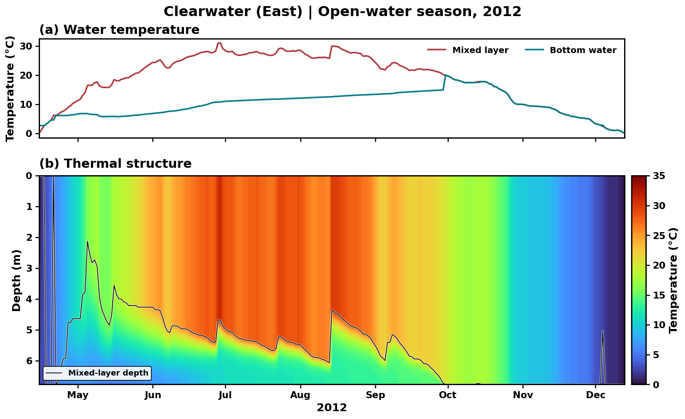
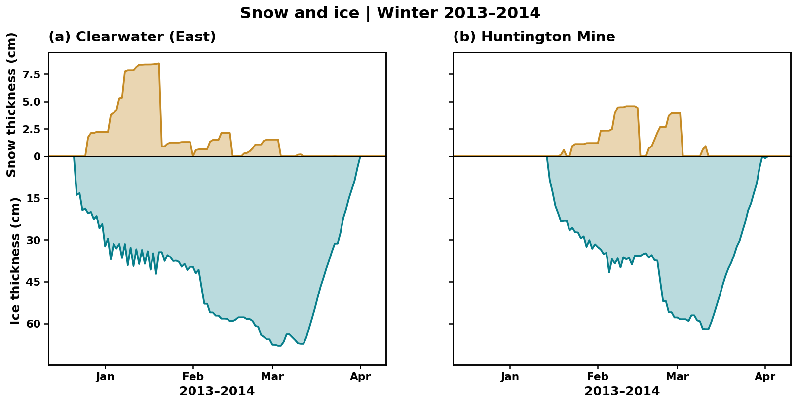

# FLake: a Python implementation

**Explore lake temperature, mixing, snow and ice in your browser.**

Choose a lake, inspect its weather inputs, select model components and run FLake. The notebook guides you from a lake's physical properties to its seasonal thermal structure and snow and ice cover. You can change the depth, fetch, initial conditions, light extinction, and snow and sediment settings to explore how the lake responds.

**No local Python installation is needed.** Open the notebook in Colab and run its cells in order. The example data download automatically during setup, once per session (about 96 MiB).

## Start with an example

1. Click **Open in Colab** and run Section 1 to load the code and data.
2. Select a lake and historical or scenario forcing.
3. Keep the example settings for a first run, then explore the model controls.
4. Run FLake and choose a year or winter to plot. Compare a second lake or download your results.

Changing a lake or forcing selection requires rerunning the subsequent sections. Model controls take effect when you rerun the simulation.

## Example dataset

| Included | Coverage |
|---|---|
| Lakes | 50 Minnesota lakes spanning a range of depths, areas and locations |
| Meteorology | GFDL-ESM4 from NEX-GDDP-CMIP6; daily incoming longwave supplied directly |
| Historical period | 1995–2014 |
| Future period | 2015–2040 under SSP1-2.6, SSP2-4.5, SSP3-7.0 and SSP5-8.5 |
| Initial states | Lake-specific beginning-of-1995 states prepared from the preceding historical run |
| Observations | Historical temperature measurements and ice dates for 45 lakes, where available |

Each scenario continues the shared historical forcing through 2014. The example uses a 365-day calendar without February 29. Measured temperature and ice records are shown separately: individual days in a climate-model realization do not represent observed local weather.

The model itself is not restricted to Minnesota. The example lakes include the regional snow-retention assignments used in the companion study. See the [user guide](docs/USER_GUIDE.md) to supply another lake and your own meteorology.

## What the notebook shows

- A lake-location map and the selected lake's physical properties.
- Mixed-layer and bottom-water temperatures, with a temperature–depth section and mixed-layer depth.
- A winter's snow thickness above the interface and ice thickness extending downward.
- Side-by-side comparisons of two lakes and seasonal ice-on/off dates.
- Available observed profiles and ice dates, and downloadable simulation data and figures.

The vertical temperature field is reconstructed from FLake's bulk layer temperatures and thermocline shape. It is the model's assumed vertical structure rather than an independent simulation at every plotted depth.

## Model and code

FLake represents one vertical water column with an upper mixed layer, an underlying thermocline, snow and ice thermodynamics, and optional bottom sediment heat exchange. The notebook provides controls for experiments while keeping the physics in a separate module.

| File | Purpose |
|---|---|
| [Run_FLake.ipynb](Run_FLake.ipynb) | Step-by-step notebook |
| `flake/configuration.py` | Lake properties, model options and initial conditions |
| `flake/inputs.py` | Input loading and validation |
| `flake/model.py` | Daily integration |
| `flake/physics.py` | FLake physics |
| `flake/profiles.py` | Vertical-temperature reconstruction |
| `flake/plotting.py` | Maps and figures |
| `flake/diagnostics.py` | Ice dates and result exports |
| `flake/observations.py` | Observed profiles and ice dates |
| `flake/notebook.py` | Lake selection and model controls |
| `flake/data_access.py` | Automatic example-data download |

The default implementation was checked against production simulations for all **250 lake/forcing combinations**. The [verification summary](verification/build_summary.json) and [per-variable checks](verification/model_checks.json) are included. These checks establish numerical agreement with the original implementation; they do not constitute validation against field measurements. Changes to the physical settings create new experiments.

## Data and editing

The code and notebook are stored here; the example data are attached to the versioned [data release](https://github.com/Sandesh710/flake-python/releases/tag/data-v1.0.0). The original tutorial ZIP is used as the data archive. Setup installs only its data files and retains the code from this repository.

To make your own version, save a copy of the notebook in Drive or fork this repository. Repository maintainers can save notebook changes back to GitHub. Reopening the GitHub Colab link loads that notebook version; a running Colab session keeps its current code until you restart or reload it. See [Maintaining the repository](docs/MAINTAINING.md).

## Attribution and citation

**Original FLake development:** Dmitrii Mironov and collaborators, German Weather Service (DWD). Original ownership notices remain in the physics module. This project presents a Python implementation and tutorial; it does not claim authorship of the original model formulation.

Mironov, D. V. (2008). *Parameterization of Lakes in Numerical Weather Prediction. Description of a Lake Model.* COSMO Technical Report No. 11. [doi:10.5676/DWD_pub/nwv/cosmo-tr_11](https://doi.org/10.5676/DWD_pub/nwv/cosmo-tr_11).

The Minnesota examples accompany: Dahal, S., Ebtehaj, A., Olmanson, L., and Hondzo, M. *Projected Changes in Thermal Structure and Ice Phenology of Lakes in the Midwestern United States Over the Next Century.* Manuscript; bibliographic details will be updated with the published version.

Additional attribution and data-source information are in [NOTICE.md](NOTICE.md). A machine-readable citation is provided in [CITATION.cff](CITATION.cff).
